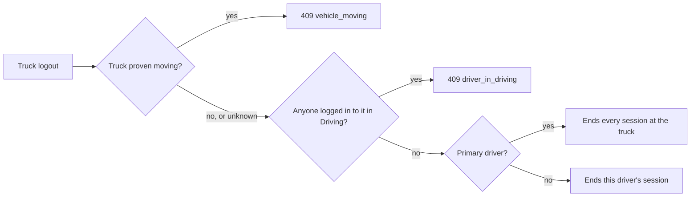

### Opening a PR

Invoked at the end of every other playbook.

**Branch.** Work on a branch off main. Subagents in this workspace share its checkout, so parallel writers each get their own `git worktree`, or run `git fetch && git reset --hard origin/<branch>` between them. Dirty branch with unrelated work: patch out, fresh branch off main, apply. Snarled branch: reset from main, redo minimally.

**Commits.** Commit liberally. Rebase into small, ordered commits before opening PRs. Each commit is a future PR: landable, ordered to tell the story. Amend when the fix belongs in a just-made commit. New commit when separable. Commit bodies don't restate the subject.

**PRs.** Run `pstack:deslop` over the diff before commit and `pstack:no-comments` before review. Write every PR title, description, and commit body with [`pstack:technical-writing`](../../technical-writing/SKILL.md) (every layer except Diátaxis, and apply the STE vocabulary rules: one word per action, keep articles, a plain verb over `-ing` where one works), then apply [`pstack:unslop`](../../unslop/SKILL.md).

**Titles.** Conventional Commits `type(scope): subject`, no trailing period. Type such as `feat`, `fix`, `docs`, `refactor`, `test`, `chore`, or `perf`. Scope is the area, such as `pstack` or `poteto-mode`. Subject is short, imperative, and names a real symbol when one carries the change, for example `fix(pstack): retarget opening-a-pr babysit trigger`.

**Descriptions.** The PR body is a briefing a reviewer skims in under 30 seconds, with the diff beside it. Do not list the changes: the diff and the commit log already show them. Use short sentences, one idea each, and no walls of text. The body becomes the squash commit body, so keep it under about 20 lines. Open with this, with no heading:

- One sentence, the bottom line: what the PR does for the user or the system.
- Three bullets of one short sentence each: **Problem** (what goes wrong today), **Decision** (the rule or design chosen, with its source: ticket, product page, CFR section, or a dated team decision), and **Expect** (what a reviewer should see the system do). Cut a bullet that runs to a second sentence back to one.
- When the decision is a flow or a set of states, such as who can end a truck session and when, a small Mermaid diagram after the bullets instead of prose.

A reader who stops after the opener knows why to merge it. It conveys the decision, not the edits that carry it out: no file names, symbols, SHAs, or "based on main" preamble.

Then add only the sections that have something to say, as `##` headings in this order:

- `## Scope`: what it deliberately leaves out, such as a follow-up or a known gap. 1–2 items.
- `## Tradeoffs`: a rejected alternative a reviewer would otherwise ask about. Skip when there was no real choice.
- `## Blast Radius`: 1–2 sentences on who or what it affects and why that is safe or risky. If main is red, state the cost of leaving it red.
- `## Verification`: 1–3 bullets, each a real check and its result. Perf: one primary number with its unit, `before → after`, and a link to the arena or swarm directory for the rest.

Name a file or symbol only when the reviewer needs it to judge a section, such as both sides of a rename.

Example, a whole PR body (gateway#69, trimmed); the outer fence is not part of it:

````markdown
Each truck now has one primary driver, and a truck session ends only when the drive is over.

- **Problem:** two drivers could both claim to drive one truck, and each truck login and logout went on the log as an ELD login and logout.
- **Decision:** one primary per truck, no ELD login or logout for a truck session, and no logout mid-drive (STA-474; team decisions, Nov 17; STA-578).
- **Expect:** a second primary or a third driver is refused, and the primary's logout ends every co-driver's session.



## Scope

- Switching who drives at a stop is STA-415, so FMCSA case ELD-FUNC-4.3.2-5 stays blocked on it.

## Blast Radius

Every truck login and logout goes through these rules. Today's app still asks for the `driving` role, and the Gateway ignores it, so logins keep working until ios #66 ships.

## Verification

- CI passes: 137 of 139 FMCSA cases pass, 0 fail, 2 are blocked.
- A curl run against this branch as the compose Gateway matched every answer in the chart.
````

After the sections, attach videos or screenshots when they prove a claim. Change lists, full SHAs, swarm or arena lane recitals, lever-correction essays, file-by-file checklists, and "CLEAN" verdicts go in a linked artifact, not the body.

**Forge.** Resolve the forge before the first PR operation and keep that choice for create, edit, view, watch, and merge. GitHub CLI (`gh`) is the default. If `command -v origin` succeeds and Origin can resolve the repository, prefer `origin pr ...`. If Origin is absent or cannot resolve the repository, stay on `gh` and record the fallback. Do not require Graphite (`gt`).

**Built-in PR tool.** When the run provides a built-in PR tool, create, edit, retarget, and mark ready through it, never through a forge CLI. A CLI-made PR misses what the tool tracks. Use the resolved forge for everything the tool does not cover, and for every PR operation when the run has no such tool.

**Size and stacks.** Prefer five narrow PRs to one large PR. A stack is a base-branch chain. The root PR targets trunk. Each child branch rebases onto its parent's exact tip and its PR targets the parent branch. As a parent merges, move its child onto trunk per `playbooks/shipping.md` step 4. Without a built-in PR tool, per the resolved forge, create a child with `origin pr create --status open --base <parent-branch>` or `gh pr create --base <parent-branch>`, and retarget one with `origin pr edit <pr> --base <parent-branch>` or `gh pr edit <pr> --base <parent-branch>`. Branch from trunk only for independent work. Rebase on trunk before substantial stack work.

**Readiness.** Open every PR ready, never as a draft. A built-in PR tool can default to draft, so set `draft: false` on every creation call through it. With Origin, pass `--status open`. With `gh`, omit `--draft`. If a PR still opens as a draft, mark it ready through the PR tool, or run `origin pr ready <number>` or `gh pr ready <number>` according to the resolved forge. Run `origin pr view <number>` or `gh pr view <number>` before you refer to PR status.

**Babysit.** Opening a PR does not start a babysit. Post the URL and keep building. Finish the phase or stack first. Run a separate babysit pass only when the user asks for one after the whole stack exists. A babysit for each new PR stalls the build and spends checks on commits later waves restart. Push back when feedback drifts from intent.

A subagent that opens a PR runs `pstack:deslop` and `pstack:no-comments`, and posts the URL. It returns to the parent without babysitting, unless it is an Autopilot-full or Autopilot-stack owner. That owner's brief assigns the babysit loop and is the ask `playbooks/babysit.md` waits for. The owner starts the loop after its code-ready report, reports merge-ready, and is exempt from the rules here and in `playbooks/babysit.md` that hold babysitting until a whole stack is built.
